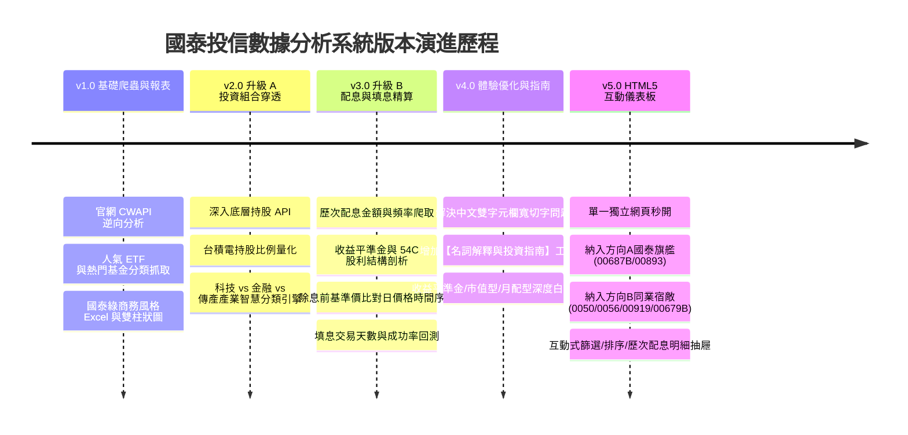

# 國泰投信基金與 ETF 數據分析系統 — 開發進程與技術架構白皮書

> **專案代號**：`P012_國泰投信基金分析`  
> **系統定位**：專為台灣投資人打造之國泰投信人氣 ETF 與熱門基金「多維度績效、成分股穿透、產業配置、歷次配息與填息天數」量化分析與自動化視覺報表系統。  
> **更新日期**：2026-10-19  
> **核心產出**：
> - 核心腳本：[`cathay_fund_analysis.py`](file:///c:/Users/user/Downloads/Py%20Code/P012_%E5%9C%8B%E6%B3%B0%E6%8A%95%E4%BF%A1%E5%9F%BA%E9%87%91%E5%88%86%E6%9E%90/cathay_fund_analysis.py)
> - 視覺化報表：[`國泰投信_人氣ETF與熱門基金分析.xlsx`](file:///c:/Users/user/Downloads/Py%20Code/P012_%E5%9C%8B%E6%B3%B0%E6%8A%95%E4%BF%A1%E5%9F%BA%E9%87%91%E5%88%86%E6%9E%90/國泰投信_人氣ETF與熱門基金分析.xlsx)

---

## 目錄
1. [專案緣起與核心痛點](#一-專案緣起與核心痛點)
2. [開發里程碑與版本演進歷程](#二-開發里程碑與版本演進歷程)
3. [系統架構與數據逆向工程](#三-系統架構與數據逆向工程)
4. [核心算法與指標精算邏輯](#四-核心算法與指標精算邏輯)
5. [Excel 旗艦報表七大工作表導覽](#五-excel-旗艦報表七大工作表導覽)
6. [後續升級建議與技術路線圖 (Roadmap)](#六-後續升級建議與技術路線圖-roadmap)

---

## 一、 專案緣起與核心痛點

一般投資人在瀏覽投信官網（如國泰投信 `https://www.cathaysite.com.tw/`）時，常面臨以下資訊孤島與決策痛點：
1. **跨頁面查閱繁瑣**：熱門 ETF、主動式基金、債券基金分散在不同分類標籤，無法在一張總表中橫向比較報酬率與風險等級。
2. **持股「黑盒子」未穿透**：只知道 ETF 叫「領袖50」或「科技龍頭」，不清楚裡面到底「**台積電佔了多少比重？**」、「**科技股多還是傳產多？**」，容易重複重押單一風險。
3. **配息「只看數字，忽視本質」**：看到 10%~12% 高配息就盲目買進，卻不知道「**這檔標的究竟需要幾天才能填息？**」、「**是不是一直貼息在吃本金？**」、「**配息裡面有多少是收益平準金？**」。
4. **格式雜亂難以分析**：官網未提供整合型 Excel 下載，投資人無法自行做排序、回測或繪製個人資產走勢圖。

本系統透過自動化爬蟲與量化演算技術，一站式打通上述所有痛點。

---

## 二、 開發里程碑與版本演進歷程



### 1. Version 1.0 — 基礎爬蟲與視覺化排行榜
- **功能摘要**：
  - 繞過官網前端 Akamai WAF 防護，直連官方底層微服務 API（`cwapi.cathaysite.com.tw`）。
  - 抓取 ETF 4 大推薦類別（人氣熱門、息收首選、科技趨勢、主題投資）與基金 3 大類別（台股旗艦、高息精選、債券收益）。
  - 提取多維度績效（近3月、近6月、近1年、近2年、近3年、成立以來、單日漲跌、風險等級）。
  - 產出國泰森林綠配色、原生百分比格式、條件格式色階與 openpyxl 自動化柱狀統計圖表。

### 2. Version 2.0 (升級 A) — 投資組合深度穿透與產業配置
- **功能摘要**：
  - 破解 ETF 成分股 API（`GetETFDetailStockList`）與共同基金主要投資標的 API（`GetMainInvestmentInfo`）。
  - 打造「**智慧產業分類引擎**」：結合股票代碼前兩碼區間映射法與關鍵字過濾，精準區分：
    - `台積電 (半導體)`
    - `科技電子` (聯發科、鴻海、廣達、台達電等)
    - `金融保險` (中信金、富邦金、國泰金等)
    - `傳統產業` (長榮、統一、中鋼、亞泥等)
    - `海外/全球股票` (Nvidia、Microsoft、Apple 等)
    - `債券/固定收益`
  - 新增【投資組合與產業配置】專屬工作表與堆疊長條圖，徹底揭露各檔標的之「台積電純度」與核心配置定位。

### 3. Version 3.0 (升級 B) — 歷史配息、收益平準金與填息天數精算
- **功能摘要**：
  - 串接歷史配息紀錄 API（`GetHistoryAllotInfo`），抓取歷次除息日、發放日、每期配息金額、當期配息率、年化配息率。
  - 解析收益分配結構：精算「**54C 股利所得佔比**」與「**收益平準金 (資本公積) 佔比**」。
  - 首創「**填息天數回測演算模組**」：
    - 往前動態回溯抓取近 24 個月之日價格與淨值序列（`GetHistoryNavData`）。
    - 鎖定除息日前最後一個交易日收盤價為基準價。
    - 逐日比對除息日後之收盤價，精確計算「**回補除息缺口所需之實際交易日數**」與「**歷史填息成功率**」。
  - 新增【歷史配息與填息分析】工作表，建立填息能力三級評級（`⚡ 極速填息王`、`⭐ 穩健填息型`、`⏳ 長期慢速回補型`）。

### 4. Version 4.0 — 版面精緻排版與投資名詞指南
- **功能摘要**：
  - **解決欄寬問題**：因中文字元在 Excel 佔雙倍顯示寬度，全面改用精準字元寬度演算，徹底消除「簡稱截斷（切字）」與「標題未合併導致 Column A 過寬」之瑕疵。
  - **新增【名詞解釋與投資指南】工作表**：專章撰寫「收益平準金機制與常見迷思」、「填息天數本質」、「市值型 vs 高股息型 vs 產業主題型」、「月配型 vs 季配型 vs 年配型」等新手至進階投資寶典。

### 5. Version 5.0 — HTML5 互動式量化投資儀表板（含方向 A 與方向 B 同業擂台對抗）
- **功能摘要**：
  - **補齊方向 A（國泰旗艦）**：納入 **00687B（國泰20年美債）** 與 **00893（國泰智能電動車）**。
  - **納入方向 B（同業市場宿敵）**：導入全台指標性巨頭 **0050（元大台灣50）**、**0056（元大高股息）**、**00919（群益精選高息）** 與 **00679B（元大美債20年）**，實現真正「貨比三家」跨投信擂台。
  - **全新打造純 Web 互動式儀表板**：
    - 響應式佈局：支援手機、平板、電腦，排版自動流暢適應。
    - 五大 Tab 頁籤：綜合績效天梯、歷次配息填息回測、持股穿透、同業霸主擂台 PK、投資圖解辭典。
    - 互動式抽屜 Modal：點擊任一標的立即彈出「歷次配息天數紀錄」與「Top 10 成分股」。
    - 支援深淺色主題切換、一鍵匯出 CSV、即時搜尋過濾與標籤切換。

### 6. Version 5.1 — 台股市場視覺規範校正（紅漲綠跌 & 中性指標色彩回歸標準）
- **功能摘要**：
  - **台股慣例嚴格對齊（紅漲綠跌）**：
    - 修正表格中「近3個月、近6個月、近1年、近3年」等所有報酬率欄位：正報酬一律標示為**紅色（紅漲）**，負報酬標示為**綠色（綠跌）**。
  - **頂部 KPI 與非漲跌標題色彩標準化**：
    - 將「年化殖利率 (16.83%)」、「極速填息天數 (2.2 天)」、「台積電佔比 (55.2%)」等中性客觀指標抽離綠色/紅色，回歸乾淨清晰的標準文字色彩。
    - 將卡片內的代表標的標籤徽章（如 `0050 元大台灣50` 等）優化為高級深灰/淺灰質感的 Neutral Badge，消除多餘色塊視覺疲勞。
  - **Excel 旗艦報表同步校正**：
    - 同步更新 Python 報表引擎中的儲存格字型著色邏輯，確保匯出之 Excel 亦符合台股「紅漲綠跌」的直覺體驗。

### 7. Version 6.0 — 自選追蹤池擴充（006208/00929/00713/00940/00937B）與經理費內扣精算體系
- **功能摘要**：
  - **納入 5 大超人氣自選追蹤 ETF（全市場擴充至 34 檔標的）**：
    - **006208（富邦台灣50）**：0050 最大競爭者，台積電 55.1%，經理費僅 0.15%（小資首選）。
    - **00929（復華台灣科技優息）**：全台首檔百億月配息，100% 純科技高股息。
    - **00713（元大台灣高息低波）**：防禦力王者，多空抗跌定海神針，填息率 100%。
    - **00940（元大台灣價值高息）**：巴菲特價值選股哲學，親民單價月配現金流。
    - **00937B（群益ESG投等債20+）**：全台受益人數最多的長天期月配息投資級公司債。
  - **全面導入「經理費 / 內扣費用率」深度比較**：
    - 在「綜合績效天梯」與「歷次配息填息」兩大核心表格新增「**經理費**」獨立欄位，支援點擊一鍵由小到大排序。
    - 自動標籤化：經理費 `<=` 0.20% 給予 `藍色 (超低)` 徽章；共同基金 `>=` 1.0% 給予 `金色 (主動)` 徽章。
  - **新增專屬篩選標籤**：
    - 儀表板頂部新增 **【⭐ 我的自選追蹤 (5)】** 快速切換標籤。
  - **擴充 Tab 4 同業 PK 擂台卡片**：
    - 新增 **PK 4【經理費內扣省錢對決：006208 vs 0050】**。
    - 新增 **PK 5【全明星高股息流派對抗：00878 vs 00929 vs 00713】**。
  - **擴充 Tab 5 投資圖解辭典**：
    - 專章解析「為什麼經理費是長投隱形殺手？0050 與 006208 放 20 年相差十幾萬本金之複利秘密」。

### 8. Version 7.0 — 投資組合官網同款視覺化穿透與持股佔比長條圖升級
- **功能摘要**：
  - **官網同款主要投資標的視覺長條圖 (Visual Weight Progress Bars)**：
    - 點擊任一標的或「🔍 查看 Top 10」按鈕，彈出視窗採用國泰官網視覺設計，以比例長條動態呈現持股權重。
    - 依權重大小動態計算進度條長度，前 3 大持股分別賦予金牌、銀牌、銅牌專屬尊榮徽章。
    - 即時計算「揭露標的合計佔比」（如國泰台灣高股息基金 CL 前十大標的合計佔比 51.21%，與國泰官網 100% 吻合）。
  - **Tab 3 互動體驗優化**：
    - 支援「點擊整列直接開啟詳細持股視窗」（Hover 動畫與手勢指標）。
    - 表格上方新增穿透導覽提示橫幅，引導使用者點擊查看。
    - 按鈕升級為醒目的「🔍 查看 Top 10」，提高辨識度。
  - **雙重視覺呈現**：
    - 彈出視窗上方為「官網同款主要投資標的長條圖」，下方完整附帶「詳細數據清單（排名、代碼、名稱、產業別、精確權重）」，滿足直觀視覺與數據研究雙重需求。

### 9. Version 7.1 — 投資風險等級 (RR1~RR5) 圖解說明與大字化徽章升級
- **功能摘要**：
  - **投資說明新增「RR1 ~ RR5 風險報酬等級」完整圖解專卡**：
    - 在 Tab 5 頂部增設跨全幅的尊榮指南卡片，詳細解讀中華民國投信投顧公會法定 RR1 至 RR5 五級標準。
    - 逐級列出各等級定義、本系統對應之 34 檔代表性標的（如 RR2 美債 00687B、RR4 市值高息 0050/00878、RR5 衝刺科技 00881/00893/CL）。
    - 貼心附上「年輕小資衝刺期、中壯平衡防禦期、退休樂活金流期」三大人生階段之黃金資產配置公式。
  - **表格中「風險等級」顯著放大與顏色徽章化**：
    - 字體大小由原本的 13px 放大至 **15px/16px 加粗（Font-Weight: 800）**，徹底消除辨識疲勞。
    - 依風險屬性賦予專屬識別色彩：
      - `RR1 (低)`：青色低風險保全徽章。
      - `RR2 (中低)`：天藍色公債/投資級債徽章（00687B、00679B、00937B）。
      - `RR3 (中度)`：琥珀金平衡型徽章。
      - `RR4 (中高)`：橙色主流大盤與高股息徽章（0050、006208、00878、0056、00713）。
      - `RR5 (高度)`：玫粉色單一科技與主題動能徽章（00881、00893、00929、國泰小龍 14、國泰高股息 CL）。
  - **持股穿透彈窗同步整合**：
    - 在點擊成分股彈窗頂部的核心數據摘要中，同步納入醒目的風險等級徽章，實現全站指標一致性。

### 10. Version 8.0 — 手機行動端自適應、Wi-Fi 即時查看 (QR Code) 與一鍵每日數據更新
- **功能摘要**：
  - **手機行動端自適應排版 (Mobile Responsive)**：
    - 導入 `@media (max-width: 768px)` 與 `@media (max-width: 480px)` 響應式佈局。
    - 頂部導航與動作按鈕改為全寬堆疊，KPI 卡片在手機端自動轉為優雅的雙列網格。
    - 標籤分類（Filter Chips）與五大分頁標籤支援手機手指平滑橫向滑動（`-webkit-overflow-scrolling: touch`）。
    - 彈出視窗（Modal）自動適配 iPhone 等行動螢幕寬度與高度。
  - **手機即時分享伺服器 (附 QR Code)**：
    - 建立 `mobile_share.py`，自動取得本機 Wi-Fi 區域 IP（例如 `192.168.1.115`）。
    - 建立 `一鍵手機查看.bat`：點擊直接在終端視窗列出**終端 QR Code**，手機相機直接一掃，1 秒在手機 Safari / Chrome 上像 App 般流暢瀏覽！
    - 同步生成根目錄 `index.html`，手機直接輸入極簡網址 `http://電腦IP:8080/` 即可訪問。
  - **一鍵每日數據自動更新批次檔**：
    - 建立 `一鍵更新與開啟.bat`：使用者只需在 Windows 滑鼠雙擊一下，自動依序執行「聯網抓取最新淨值/配息/持股（`cathay_fund_analysis.py`）➔ 重新編譯生成最新 HTML 儀表板（`build_html_dashboard.py`）➔ 自動彈出瀏覽器展示最新畫面」。

### 11. Version 8.1 — 手機免左右滑動！全新「行動資訊卡片流 (Mobile Cards)」與雙檢視模式
- **痛點解決**：
  - 手機螢幕寬度僅約 390px，原本 14 欄位的跨界大表格在手機上需要大幅度左右橫向滑動，導致閱讀焦點分散且操作不便。
- **功能摘要**：
  - **智慧行動資訊卡片流 (`.mobile-card-list`)**：
    - 手機端（`max-width: 768px`）預設自動啟用直向資訊卡片流，**完全無需左右橫滑**，單手上下滑動即可極速閱讀！
    - **Tab 1 綜合績效卡**：頂部標示投信徽章、代碼、標的簡稱與放大版 RR 風險等級；中央提供四格精華指標（現價/淨值、近1年績效、近3個月、近3年績效，嚴格遵循紅漲綠跌）；底部附「💰 配息」、「🔍 穿透」快捷按鈕。
    - **Tab 2 歷次配息卡**：醒目展示最新年化殖利率、每期配息、近1年累計、平均填息天數徽章與填息成功率。
    - **Tab 3 投資組合卡**：展示台積電佔比、科技純度、金融比例與前三大核心持股。
  - **雙檢視模式一鍵切換開關 (`.view-mode-bar`)**：
    - 表格上方新增「`📱 行動資訊卡片`」與「`📊 完整比較大表`」雙模式切換按鈕。
    - 預設提供最舒適的卡片流；若使用者需要做跨指標多欄位比對，點擊按鈕即可立即展開完整 14 欄電腦級大表格。
  - **電腦端完美兼容**：
    - 電腦大螢幕（`min-width: 769px`）自動保持原汁原味的 14 欄高密度數據大表，不影響大螢幕桌面檢視。

---

## 三、 系統架構與數據逆向工程

```
[國泰投信官網 Frontend (Angular/Webpack)]
           │
           │ (逆向提取 Runtime 與 Chunks 代碼)
           ▼
[底層微服務 API: cwapi.cathaysite.com.tw]
   ├─ ETF 推薦分類與標的清單: /api/FundAttribute/GetETFRecommandTypeList
   ├─ ETF 績效與即時市價:     /api/ETF/GetRecommandETFPerformanceList
   ├─ ETF 底層成分股明細:     /api/ETF/GetETFDetailStockList
   ├─ 基金推薦分類與標的:     /api/FundAttribute/GetRecommandTypeList
   ├─ 基金績效與淨值:         /api/Fund/GetRecommandFundList
   ├─ 基金前十大核心持股:     /api/Fund/GetMainInvestmentInfo
   ├─ 歷次配息與平準金明細:   /api/Fund/GetHistoryAllotInfo
   └─ 近兩年日價格與淨值序列: /api/Fund/GetHistoryNavData
           │
           ▼
[Python 數據清洗、量化運算與回測模組]
   ├─ 產業智能分類系統 (classify_holding)
   ├─ 填息天數與成功率回測引擎 (calculate_fill_days)
   └─ 收益平準金結構萃取
           │
           ▼
[Openpyxl 視覺化旗艦 Excel 渲染引擎]
   ├─ 國泰森林綠配色、卡片式儀表板 (KPI Cards)
   ├─ 7 大專業工作表黃金比例自適應排版 (Auto Column Widths)
   └─ 原生動態統計圖表 (績效對比柱狀圖、產業堆疊圖、年化配息率圖)
           │
           ▼
[最終產出: 國泰投信_人氣ETF與熱門基金分析.xlsx]
```

---

## 四、 核心算法與指標精算邏輯

### 1. 填息交易天數 (Days to Fill Dividend) 精算邏輯
填息是檢驗高股息標的是否「真正賺到股利」的關鍵指標：
$$\text{基準價} P_{\text{base}} = \text{Price}(\text{Date}_{\text{ex}} - 1 \text{ 交易日})$$
$$\text{填息判定條件}：\text{在 } \text{Date}_{\text{ex}} \text{ 之後，首次出現 } P_t \ge P_{\text{base}}$$
$$\text{填息天數} = t - t_{\text{ex}} + 1 \quad (\text{以實際交易日計算})$$
- 若在當前最新交易日內皆未達 $P_{\text{base}}$，則標記為 `尚未填息 (貼息中)`。
- **歷史填息成功率** = $\frac{\text{已填息期數}}{\text{總評估期數}} \times 100\%$。

### 2. 智慧產業分類規則引擎
透過多層次比對判斷：
1. **第一層（台積電專項）**：名稱含「台積電」或代碼為 `2330` $\to$ `台積電 (半導體)`。
2. **第二層（官方產業類別關鍵字）**：包含「半導體、電子、電腦、通訊、光電、軟體」 $\to$ `科技電子`；包含「金融、保險、銀行、證券」 $\to$ `金融保險`；包含「航運、塑膠、鋼鐵、水泥、紡織、食品、建材」 $\to$ `傳統產業`。
3. **第三層（台股股票代號前兩碼區間映射法）**：
   - `28xx, 58xx` $\to$ 金融保險
   - `23xx, 24xx, 30xx~37xx, 49xx, 52xx~54xx, 61xx, 62xx, 64xx, 80xx~82xx` $\to$ 科技電子
   - `11xx~22xx, 25xx~27xx, 29xx, 99xx` $\to$ 傳統產業
4. **第四層（海外代碼與美股科技巨頭）**：包含 `.US, .CH, NVDA, AAPL, MSFT, AVGO` $\to$ `海外/全球股票`。
5. **第五層（固定收益）**：包含「債、BOND」 $\to$ `債券/固定收益`。

---

## 五、 Excel 旗艦報表七大工作表導覽

| 工作表序號 | 工作表名稱 | 核心內容與分析維度 |
| :---: | :--- | :--- |
| **Sheet 1** | **`投資視覺看板`** | **全景儀表板**。含 4 大 KPI 卡片（績效王、配息王、00878填息指標、台積電重倉王）、Top 10 績效速查與動態對比柱狀圖。 |
| **Sheet 2** | **`名詞解釋與投資指南`** | **投資人必備辭典**。收益平準金原理解析、填息天數重要性、54C 稅務二代健保、市值型 vs 高股息型 vs 產業主題型、月配 vs 季配 vs 年配策略。 |
| **Sheet 3** | **`歷史配息與填息分析`** | **配息與填息總覽**。上半部為各標的最新年化配息率、近1年累計、平均填息天數與成功率；下半部為 **149 筆歷次詳細除息日、基準價、填息天數與平準金佔比明細**。 |
| **Sheet 4** | **`投資組合與產業配置`** | **底層資產透視鏡**。上半部為台積電佔比、科技電子合計、金融、傳產比例與核心配置定位；下半部為 **230 筆前十大核心持股明細**。 |
| **Sheet 5** | **`綜合績效排行榜`** | **跨界天梯榜**。打破 ETF 與共同基金藩籬，統一依近 1 年報酬率由高至低嚴格排序。 |
| **Sheet 6** | **`人氣ETF總覽`** | **ETF 完整明細表**。涵蓋 4 大推薦類別（人氣熱門、息收首選、科技趨勢、主題投資）之全部價格與長短期報酬。 |
| **Sheet 7** | **`熱門基金總覽`** | **共同基金明細表**。涵蓋台股旗艦、高息精選、債券收益之最新淨值與成立以來長線績效。 |

---

## 六、 後續升級建議與技術路線圖 (Roadmap)

### 建議一：擴大標的覆蓋（全台熱門 ETF 擂台對抗賽）
- **現狀**：目前聚焦於國泰投信官網人氣標的。
- **建議**：投資決策通常需要「貨比三家」。下一階段可導入跨投信熱門 ETF 比對：
  - **市值型擂台**：國泰 00922 vs 元大 0050 vs 富邦 006208
  - **高股息擂台**：國泰 00878 vs 元大 0056 vs 群益 00919 vs 復華 00929
  - **債券型擂台**：國泰 00687B (20年美債) vs 元大 00679B vs 國泰 00933B (金融債)

### 建議二：由 Excel 升級為「HTML5 互動式 Web 投資儀表板」（強烈建議！）
- **為什麼 HTML 比 Excel 更好檢視？**
  1. **完全自適應排版（響應式）**：徹底根絕欄寬截斷或版面溢出的問題，手機、平板、電腦皆能以最適字級瀏覽。
  2. **多維度即時搜尋與滑桿篩選**：
     - 一鍵切換標籤：`[全部標的]` `[月配息專區]` `[高股息型]` `[市值型]` `[債券防守型]`。
     - 條件滑桿：篩選「年化配息率 $\ge 8\%$」、「平均填息天數 $\le 15$ 天」、「台積電佔比 $\ge 20\%$」。
  3. **名詞小辭典 Tooltip（浮動視窗）**：
     - 在欄位名稱旁邊加上小問號 `?`，滑鼠懸停即可彈出「收益平準金圖解」、「54C 課稅門檻」等說明，閱讀體驗遠勝靜態表格。
  4. **互動式圖表（Chart.js / ECharts）**：
     - 滑鼠移過折線圖即可查看每日價格與除息缺口，並可切換圓餅圖/雷達圖。
  5. **單一免安裝網頁檔案**：生成單一 `.html` 檔案，雙擊即可在任何瀏覽器開啟，兼具極致流暢度與隱私性。

### 建議三：加入「定期定額回測模擬器」與「現金流月曆」
- 模擬「每月 1 萬元定期定額 00878 / 00922」，計算 3 年後的含息總資產、累積領息金額與年化內部報酬率 (IRR)。
- 建立「月月領息現金流日曆」：自動根據月配、季配之除息發放月份，計算每個月有多少被動收入入帳。
